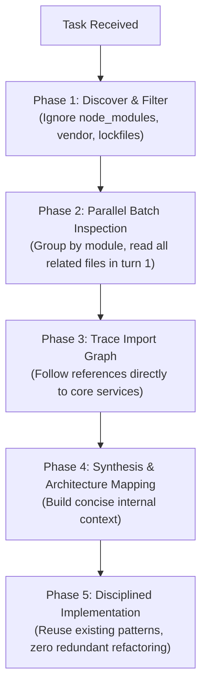

# Efficient Codebase Exploration Protocol

A strict, token-conscious operational standard for AI IDE agents to inspect, explore, and map software projects rapidly without context bloat, sequential read lag, or unauthorized package operations.

---

## The Core Philosophy: Surgical Exploration

Traditional AI agents waste massive amounts of tokens and interaction turns by:
1. Opening files one-by-one in isolated sequential tool calls.
2. Repeatedly re-reading the same files and re-listing identical directory paths.
3. Diving deep into third-party vendor directories (`node_modules/`, `vendor/`).
4. Running unauthorized package manager commands (`npm install`, `composer update`).
5. Implementing changes before developing a cohesive mental model of existing architecture.

---

## 1. Batch File Reading (Never One-by-One)

- [ ] **Discover First, Read in Batches:**
  - Before reading, identify the candidate cluster of relevant files using targeted pattern discovery (`grep -rn`, file path listing).
  - 🚫 **Never issue single sequential `read_file` calls across multiple conversation turns** when files can be requested concurrently.
  - Issue all independent `read_file` calls in a **single turn in parallel**.
- [ ] **Module & Directory Grouping:**
  - Group reading operations by feature vertical or architectural layer (e.g. read the route, controller, service, and DTO together in one batch).
- [ ] **Zero Re-Reading:**
  - Never re-read a file whose content has already been inspected in the conversation transcript unless it was modified by an external process.
- [ ] **Substantial Range or Full File:**
  - Read files completely or in substantial logical blocks (within tool limits). Reading 10 lines at a time wastes tokens through repeated tool framing.

> **Deep Dive:** Consult [`references/batch-reading-playbook.md`](references/batch-reading-playbook.md).

---

## 2. Intelligent Codebase Exploration

- [ ] **High-Signal File Hierarchy:**
  Prioritize files in this strict sequence:
  1. *Architecture anchors:* `README.md`, entry points (`main.ts`, `index.js`, `app.py`, `routes/api.php`).
  2. *Contract definitions:* OpenAPI specs, router tables, interface schemas, DTOs.
  3. *Business logic:* Handlers, controllers, domain services, Eloquent/Prisma/TypeORM models.
  4. *Component trees:* Relevant UI views or client components directly involved in the user request.
- [ ] **Follow the Import Graph Surgically:**
  - When investigating a feature, do not wander through unreferenced sibling directories.
  - Read the entry file, extract import statements, and directly batch-read the exact imported modules.
- [ ] **Concise Architectural Synthesis:**
  - Maintain a lightweight mental summary: stack framework, state management approach, ORM/DB layer, and conventions.
  - Do not regurgitate full file bodies into conversation prose.

> **Deep Dive:** Consult [`references/import-graph-traversal.md`](references/import-graph-traversal.md).

---

## 3. Token & Time Optimization

- [ ] **Batch Shell Execution:**
  - Chain dependent command checks with `&&` and independent inspections with `;` into a single tool turn.
- [ ] **Targeted Grepping Over Whole-Tree Scans:**
  - Use regex/literal greps with exclusions (`--exclude-dir={node_modules,vendor,.git,dist}`) to jump directly to symbol definitions.
- [ ] **Selective Context Ingestion:**
  - Avoid loading massive JSON fixtures, build artifacts (`.map`), compiled bundles, or minified files into context.
- [ ] **Never List Entire Deep Trees:**
  - Avoid unrestricted `find .` or `tree -a`. Limit directory depth (`find . -maxdepth 2`) or use targeted scripts.

> **Deep Dive:** Consult [`references/token-budget-heuristics.md`](references/token-budget-heuristics.md).

---

## 4. Strict Package Manager Restrictions

> [!CAUTION]
> **Dependency Directory Isolation:**
> Never inspect, read, grep, modify, or execute files inside third-party dependency directories unless explicitly instructed by the user.

- [ ] **Forbidden Directory Inspection:**
  - 🚫 `node_modules/`
  - 🚫 `vendor/`
  - 🚫 `.venv/`, `venv/`, `site-packages/`
  - 🚫 `.next/`, `dist/`, `build/`
- [ ] **Prohibited Package Commands:**
  - 🚫 **Never run:** `npm install`, `npm update`, `npm audit fix`, `yarn add`, `pnpm install`.
  - 🚫 **Never run:** `composer install`, `composer update`, `composer require`.
  - 🚫 **Never run:** `pip install`, `poetry install`, `pipenv update`.
  - 🚫 **Never edit or regenerate lockfiles:** (`package-lock.json`, `composer.lock`, `pnpm-lock.yaml`, `poetry.lock`) unless explicitly asked.
  - *Exception:* If the user explicitly asks: "install package X" or "run composer update".

> **Deep Dive:** Consult [`references/dependency-guardrails.md`](references/dependency-guardrails.md).

---

## 5. Implementation Discipline

- [ ] **Understand First, Implement Second:**
  - Never edit a file until its dependencies, callers, and configuration context have been batch-inspected.
- [ ] **Reuse Existing Patterns:**
  - Match project naming conventions (camelCase vs snake_case), error handling idioms, and database query builders.
  - Do not introduce new third-party libraries when existing utilities in the project already solve the problem.
- [ ] **Zero Gratuitous Refactoring:**
  - Touch only the lines and components required to satisfy the user request.
  - Do not reorganize untouched functions, rewrite styles, or reformat files outside the immediate scope.
- [ ] **Targeted Verification:**
  - Execute only the unit tests or scripts relevant to the edited functionality.
  - Do not run comprehensive project-wide builds that reinstall dependencies.

---

## 6. Pre-Flight Exploration Checklist

Before starting any exploration or modification task:
- [ ] Candidate files discovered and filtered to exclude `vendor/`, `node_modules/`, and `.git/`.
- [ ] All related files (router, service, model, test) grouped for parallel batch reading.
- [ ] Zero sequential one-by-one file reading across separate turns.
- [ ] No unauthorized package manager operations scheduled.
- [ ] Target symbol located via import tracing or targeted grep.
- [ ] Existing architecture and coding idioms confirmed before making edits.
