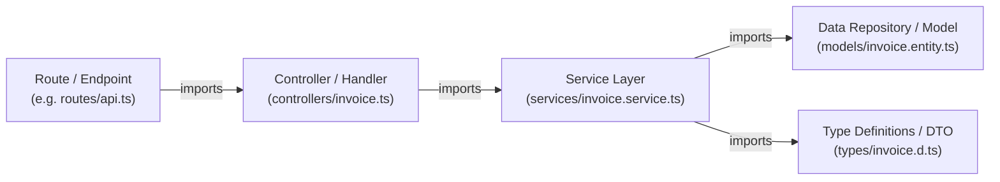

# Import Graph Traversal & Reference Tracing

A methodology for surgical codebase navigation by following imports, dependency injections, and symbol references directly rather than scanning projects haphazardly.

---

## 1. The Principle of Targeted Traversal

Do not guess which files are relevant by browsing directory trees. Begin at the task's functional anchor (the URL route, command handler, or UI entry point) and traverse outward along the import graph.



---

## 2. Multi-Language Import Tracing Patterns

### 2.1 TypeScript & JavaScript (ESM / CommonJS)
Look at the top of the file:
```typescript
import { InvoiceService } from '@/services/invoice.service';
import { CreateInvoiceDto } from '../dtos/create-invoice.dto';
```
- Resolve alias `@/` against `tsconfig.json` paths (usually maps to `./src/`).
- Relative imports (`../`, `./`) are resolved relative to the current file's directory.
- Add both `@/services/invoice.service.ts` and `../dtos/create-invoice.dto.ts` to the **immediate batch-read plan**.

### 2.2 Python (Django, FastAPI, Flask)
```python
from app.services.billing import process_payment
from .models import Invoice, LineItem
```
- Follow `app.services.billing` to `app/services/billing.py` (or `app/services/billing/__init__.py`).
- Relative `.` maps to sibling module in the same package directory.

### 2.3 PHP (Laravel / PSR-4)
```php
namespace App\Http\Controllers;

use App\Services\PaymentService;
use App\Models\Order;
```
- In Laravel / PSR-4: `App\` maps to `app/`.
- `App\Services\PaymentService` $\to$ `app/Services/PaymentService.php`.
- Batch-read the controller, service, and model together.

---

## 3. Tracing Downstream Callers (Reverse Traversal)

When asked: *"Where is this function called?"* or *"Who uses this component?"*:

1. **Avoid full tree scans.** Search only across relevant application source folders (`./src`, `./app`, `./lib`).
2. **Formulate a specific grep target:**
   ```bash
   grep -rn "calculateInvoiceTax(" ./src --exclude-dir={node_modules,dist,.git}
   ```
3. Batch-read the caller locations in a single follow-up tool turn.
