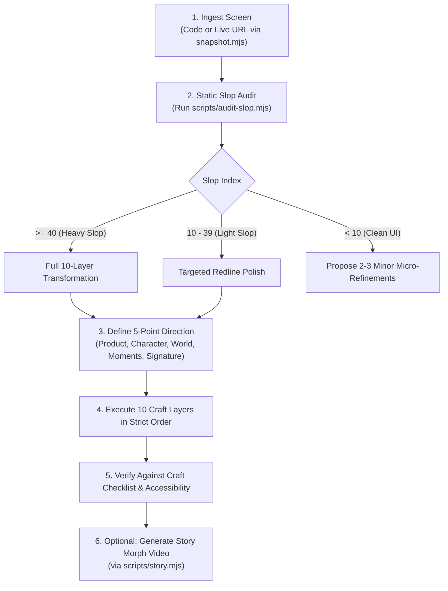

# UI Slop Remediation Protocol

An advanced design-engineering standard for identifying, redlining, and transforming vibecoded AI slop into deliberate, production-grade digital craft.

---

## The Philosophy of Interface Craft

Vibecoded and AI-generated interfaces fail in predictable, repetitive ways. Every surface has a purple gradient, every card has an intense colored glow, labels are littered with emojis (`✨`, `🚀`), spacing values are random arbitrary numbers (`mt-[13px]`), and copy shouts meaningless hype words (`supercharge`, `seamlessly`, `unlock`).

**Removing slop is only half the battle.** A screen that is merely clean but could belong to any company is just a new template. High-craft engineering ensures:
1. **Quiet Chrome, Rich Content:** Navigation, cards, sidebars, and borders remain disciplined and calm. Color and textural richness are concentrated strictly in one or two signature moments (a tangible hardware card, an interactive instrument chart, or a tactile product preview).
2. **Distinctive Character:** The interface derives its palette, typography, and density from the physical world of the product (e.g. an observability tool adopts avionics/instrument tokens; a financial ledger adopts paper-and-ink or mint-engraving tokens).
3. **Mathematical Rhythm:** All spacing adheres strictly to a 4px grid; corner radiuses follow the nested radius formula ($r_{\text{inner}} = \max(0, r_{\text{outer}} - \text{padding})$); borders are quiet hairlines at 6–10% opacity.
4. **Authentic Copy & Data:** Zero hype words, zero exclamation marks, and zero fake numbers. Every metric has a real-world comparison baseline (`+12% vs last month`).

---

## Operational Execution Workflow



---

### Step 1: Ingestion & Environmental Baseline
- **Local Source Files:** Inspect the source code directly (React/Next.js, Vue, Svelte, Tailwind, or plain HTML/CSS).
- **Live Site or Link Only:** Capture the live DOM and computed styles into a clean local workspace:
  ```bash
  node ui-slop-remediation/scripts/snapshot.mjs <url> ./remediation/original.html --dark
  ```
  *(Captures an inlined, offline-editable HTML file and an accompanying `original.live.png` screenshot).*
- **Screenshot Only:** Rebuild the layout as a clean standalone HTML/Tailwind skeleton first before starting the remediation passes.

---

### Step 2: Automated Slop Audit & Scoring

Run the static analysis scanner to quantify the interface's **Slop Index** ($0 - 100$):
```bash
node ui-slop-remediation/scripts/audit-slop.mjs <path-to-file-or-dir>
```
The scanner checks:
- **Surface & Effects:** Purple/violet gradient ramps, glowing drop shadows (`shadow-[0_0_*]`), text gradient clipping (`bg-clip-text`).
- **Typography & Iconography:** Emoji used in labels/buttons, tracked uppercase headings, missing `tabular-nums`.
- **Spacing Inconsistencies:** Arbitrary pixel classes (`mt-[13px]`, `py-[11px]`).
- **Copy Hype:** Buzzwords (`supercharge`, `seamlessly`, `magic`, `AI-powered`, `game-changing`).

#### Triage Gate
- **Heavy Slop ($\ge 40$):** Run the complete 10-layer transformation sequence.
- **Light Slop ($10 - 39$):** Surgical polish. Retain existing brand colors and font families; remediate only the flagged violations.
- **Clean UI ($< 10$):** Do not redesign. Report the clean score and suggest at most 2–3 micro-refinements (e.g. adding tabular figures or tightening a nested border radius).

---

### Step 3: Define the 5-Point Product Direction

Before touching a single line of CSS or markup, formulate and lock in the 5-point direction derived strictly from the product's actual purpose (never from generic design trends):

1. **Product:** Exactly what the product does and for whom in one declarative sentence.
2. **Character:** 2–3 concrete, non-cliché adjectives (e.g., `tactile, clinical, fast` or `archival, editorial, warm`). *(Banned words: clean, modern, sleek, minimal, premium).*
3. **World:** The physical domain the product naturally belongs to. Choose from the 6 curated architectural worlds in [`references/craft-tokens.md`](references/craft-tokens.md):
   - *Graphite & Steel* (Infrastructure, developer tools)
   - *Swiss & Archival* (Publishing, documentation, knowledge)
   - *Avionics & Cockpit* (Telemetry, observability, real-time data)
   - *Paper & Ink* (Notes, personal productivity, legal)
   - *Warm Industrial* (Commerce, manufacturing, physical logistics)
   - *Obsidian Terminal* (Cybersecurity, low-light operations)
4. **Moments:** 1 or 2 specific places where richness is allowed to live (e.g., a laser-etched hardware card, a multi-series sparkline chart, or a physical-texture preview).
5. **Signature:** Exactly one small recurring detail unique to this product (e.g., live telemetry heartbeat dot, monospace keyboard keycaps, or currency stamping).

---

## The 10-Layer Craft Transformation Engine

Execute the transformation passes **strictly in order across the entire screen**. Do not jump ahead.

```text
Layer 0: Accessibility & Semantic Structure
Layer 1: Spacing & Alignment Grid (4px Scale)
Layer 2: Surfaces, Palettes & Contrast (Quiet Chrome)
Layer 3: Iconography & Badges (Line Sets & No Emoji)
Layer 4: Copywriting & Metric Realism (De-Hyping)
Layer 5: Typography & Tabular Alignment (Type Ramps)
Layer 6: Layout, Proportions & Viewport Composition
Layer 7: Micro-Details, Hairlines & Nested Radii
Layer 8: Visual Moments & Tangible Objects
Layer 9: Motion & Micro-Interactions
```

---

### Layer 0: Accessibility & Semantic Structure
- [ ] **Semantic Elements:** Replace all `<div onclick="...">` with native `<button>` or `<a>` elements.
- [ ] **Heading Order:** Ensure a single logical `<h1>` followed by unbroken `<h2>` and `<h3>` tags.
- [ ] **Visible Focus Rings:** Never allow `outline: none` without a high-contrast replacement ring (`focus-visible:ring-2 focus-visible:ring-offset-2`).
- [ ] **Contrast Compliance:** Guarantee all text meets WCAG 2.2 AA ratios (minimum **4.5:1** for regular text, **3.0:1** for large text and interactive borders).

---

### Layer 1: Spacing & Alignment Grid
- [ ] **Strict 4px Scale:** Convert all padding, margin, gap, and height values to multiples of 4 (e.g., 4, 8, 12, 16, 20, 24, 32, 40, 48, 64px).
- [ ] **Eliminate Arbitrary Nudges:** Delete one-off Tailwind values like `mt-[13px]`, `px-[17px]`, `top-[3px]`.
- [ ] **Columnar Alignment:** Icons align in one shared column width (e.g. `w-5`); labels begin on identical horizontal baselines; numbers align flush right.
- [ ] **Visual Proximity Law:** Gap inside a grouped component must be strictly smaller than the gap separating component groups ($gap_{\text{internal}} < gap_{\text{external}}$).
- [ ] **Dense Sidebar Spacing:** Sidebar navigation items must be compact (height 32–36px with 2–4px gap).

---

### Layer 2: Surfaces, Palettes & Contrast
- [ ] **Tinted Neutral Ramp:** Build backgrounds, surfaces, and borders from a single neutral ramp tinted toward the chosen World (e.g. graphite, cool slate, warm stone).
- [ ] **Quiet Chrome:** Sidebars, main headers, and background cards must stay neutral. They must never be colored orange, purple, or green.
- [ ] **Three Text Roles:** Limit typography strictly to Primary (high contrast), Secondary (medium contrast), and Muted (meta labels).
- [ ] **Single Accent Rule:** One single accent color on the screen, reserved strictly for primary calls-to-action or critical selections.
- [ ] **Eliminate Slop Effects:**
  - 🚫 Purge all hue gradients on surfaces (e.g. `bg-gradient-to-r from-purple-500 to-indigo-600`).
  - 🚫 Delete gradient text (`bg-clip-text text-transparent`).
  - 🚫 Strip glowing drop shadows (`shadow-[0_0_25px_...]`).
  - 🚫 Remove colored background blobs and radial gradients behind text.
- [ ] **Depth Through Stepping:** On dark interfaces, achieve depth using surface steps (`#121214` $\to$ `#18181b` $\to$ `#222226`) and hairline borders, not heavy drop shadows.

---

### Layer 3: Iconography & Badges
- [ ] **Eliminate UI Emojis:** Remove all emojis used as buttons, nav icons, or card decors (🏠 $\to$ `Home`, 🚀 $\to$ `Rocket`, 💰 $\to$ `Banknote`).
- [ ] **Single Icon Family & Weight:** Use one consistent SVG icon library (e.g. Lucide, Heroicons, Phosphor) at uniform dimensions (16px or 18px) with 1.5px stroke width.
- [ ] **Neutral Icon Colors:** Icons inherit the color of their accompanying text role (`text-muted-foreground` or `text-foreground`). Icons do not get independent rainbow fills.
- [ ] **De-Slop Badges:** Remove fake hype tags like `PRO ✨`, `New 🔥`, `Beta 🚀`. Essential status badges must be quiet text with an optional 6px solid dot.

---

### Layer 4: Copywriting & Metric Realism
- [ ] **De-Hyping:** Replace all buzzwords (`supercharge`, `seamlessly`, `unlock the magic`, `revolutionary AI`) with plain, factual descriptions of what the product actually does.
- [ ] **No Exclamation Points:** Strip exclamation points and double punctuation (`!!`) from all interface copy.
- [ ] **Eliminate Greeting Clichés:** Delete "Welcome back, Yash! 👋". Use context-anchored headlines (e.g., "Telemetry Dashboard", "October 2026 Overview").
- [ ] **No Trailing Periods:** Strip trailing periods from buttons, labels, navigation items, and card titles.
- [ ] **Comparative Baselines:** Every change metric must state its comparison benchmark (`+12.4% vs last 30 days`, not `+12.4%!!`).
- [ ] **Plausible Mock Data:** Replace generic `$123,456` or placeholder names with realistic names, real currency formats, and authentic domain terminology.

---

### Layer 5: Typography & Tabular Alignment
- [ ] **Disciplined Weight Range:** Use only weights 400 (regular) and 500 (medium). Reserve 600 (semibold) strictly for rare optical emphasis. 🚫 Never use weight 800 or 900 for headings.
- [ ] **Sentence Case Everywhere:** Convert all uppercase tracked labels (`PAYMENTS OVER TIME`, `NAVIGATION`) to clean sentence case (`Payments over time`, `Navigation`).
- [ ] **Letter Spacing Rules:** Never apply negative letter spacing (`tracking-tight`) to small text ($< 14\text{px}$). Tight tracking is reserved exclusively for display titles ($> 32\text{px}$).
- [ ] **Tabular Numerics:** Add `tabular-nums` (font-variant-numeric: tabular-nums) to all timestamps, monetary figures, metrics, and data tables.
- [ ] **Uniform Metric Formatting:** Standardize numeric decimals and currency symbols across the screen.

---

### Layer 6: Layout, Proportions & Viewport Composition
- [ ] **True Desktop Shell:** Dashboards and applications must fill desktop viewports naturally (sidebar 240–280px, fluid main workspace up to 1440–1600px). Never trap a desktop tool inside a cramped centered column.
- [ ] **Hero Architecture:**
  - *Option A (Scene Hero):* One atmospheric, wide visual fills the hero container with calm empty space reserved for high-contrast left-aligned copy.
  - *Option B (Asymmetric Split):* Text block on the left (40–45% width) paired with a rich, tangible product view on the right (55–60% width).
  - 🚫 Avoid the generic "stacked-center" template layout where small badges, titles, subtitles, and two pill buttons are centered identically.
- [ ] **Mobile Responsiveness:** Dense desktop previews adapt gracefully on mobile viewports: simplify rows and columns instead of scaling down font sizes below 11px.

---

### Layer 7: Micro-Details, Hairlines & Nested Radii
- [ ] **Nested Radius Mathematics:** Maintain optical harmony between parent cards and child elements:
  $$r_{\text{inner}} = \max\left(4\text{px},\, r_{\text{outer}} - \text{padding}\right)$$
  *(e.g., if a card has $r_{\text{outer}} = 16\text{px}$ and $\text{padding} = 12\text{px}$, the button inside must have $r_{\text{inner}} = 4\text{px}$, not 9999px).*
- [ ] **Hairline Borders:** Borders should be subtle hairlines using the text color at 6% to 10% opacity (`border-white/[0.08]` or `border-black/[0.08]`).
- [ ] **Tactile Keycaps:** Represent keyboard shortcuts using authentic micro-keycaps (`<kbd class="px-1.5 py-0.5 text-[10px] font-mono rounded border bg-muted">⌘K</kbd>`).
- [ ] **Chart Hierarchy:** Exactly one primary chart commands the visual hierarchy. Secondary charts must be downscaled into compact sparklines or ranked tabular bars.

---

### Layer 8: Visual Moments & Tangible Objects
- [ ] **Product-Derived Richness:** Rather than AI orbs, floating cubes, or purple nebulas, engineer rich moments using real product artifacts:
  - Financial apps: A credit card rendered in code with realistic micro-textures, chip geometry, and embossed typography.
  - Telemetry apps: Live vector waveform graphs, latency gauges, or laser-etched server blade badges.
  - Logistics apps: Route vectors, coordinates, and authentic manifest tables.
- [ ] **Code-Crafted SVGs:** Whenever possible, construct rich artifacts natively in SVG and CSS rather than static images for razor-sharp rendering at all display densities.
- [ ] **Guidance for AI-Generated Heroes:** If a hero scene is required, consult [`references/visuals-and-hero-craft.md`](references/visuals-and-hero-craft.md) for camera, lighting, and negative-space prompt formulas.

---

### Layer 9: Motion & Micro-Interactions
- [ ] **Eliminate Looping Motion:** Remove `animate-pulse`, `animate-bounce`, and infinite shimmer gradients unless representing a genuine live connection.
- [ ] **Remove `transition-all`:** Explicitly declare animated properties (`transition-colors`, `transition-transform`) to avoid layout recalculation stutter.
- [ ] **Micro-Durations:** Use short, crisp transitions:
  - Hover states: 120ms–150ms (`ease-out`)
  - Active/press states: 75ms
  - Dialog / Drawer entry: 200ms–250ms with subtle scale ($0.98 \to 1.0$)
- [ ] **Accessible Reduced Motion:** Always provide `@media (prefers-reduced-motion: reduce)` fallbacks that disable translations and preserve instant feedback.

---

## Story Video & Morphing Presentation Generator

To present an interactive before/after animation demonstrating the interface undergoing craft remediation:

1. **Construct the Story Document:** Create `remediation-story/story.html` based on the template in [`scripts/story.mjs`](scripts/story.mjs).
2. **Assign Redline Calipers:**
   - Add `data-gap="sidebar"` or `data-gap="main"` to elements across vertical stacks to display live millimeter/pixel measurement brackets that count down during the morph.
   - Add `data-radius` to corner-smoothed cards to display dynamic radius indicators.
3. **Execute Story Video Render:**
   ```bash
   node ui-slop-remediation/scripts/story.mjs remediation-story/story.html output-remediation.mp4 --wide
   ```
   *(Requires Playwright and ffmpeg. Produces smooth 60fps MP4 recording showing CSS morphing smoothly between steps).*

---

## Strict Anti-Patterns ("Do Not")

- 🚫 **Do not invent fake brand identities:** Preserve the product's actual name, domain, and purpose.
- 🚫 **Do not replace one trend with another:** Never swap purple gradients for aggressive glassmorphism, noisy neon cyber grids, or gratuitous 3D blobs.
- 🚫 **Do not sacrifice readability for minimalism:** Do not hide essential controls behind mystery-meat navigation or low-contrast gray-on-gray text.
- 🚫 **Do not use emoji in professional UI:** Replace all emojis with cohesive line icons.
- 🚫 **Do not break accessibility:** Every button must be keyboard focusable; every text block must pass WCAG 2.2 AA contrast.

---

## Verification & Hand-off Checklist

- [ ] **Automated Scan Passed:** `audit-slop.mjs` returns Slop Score $< 10$.
- [ ] **4px Rhythm Maintained:** All margins, paddings, and heights align with the 4px scale.
- [ ] **Quiet Chrome:** Sidebars, navigation bars, and backgrounds are built with neutral ramps.
- [ ] **Single Accent Color:** Only one primary accent color is utilized for focal actions.
- [ ] **Zero Slop Effects:** No colored glows, no text gradients, no radial color splashes.
- [ ] **Zero UI Emojis:** All emojis removed or replaced with monochromatic line icons.
- [ ] **De-Hyped Copy:** No exclamation points, no greeting headlines, no buzzwords.
- [ ] **Tabular Figures:** Numbers and metrics formatted with `tabular-nums` and comparison baselines.
- [ ] **Nested Radii Harmonized:** Child radiuses calculated via $r_{\text{inner}} = \max(0, r_{\text{outer}} - p)$.
- [ ] **Tangible Product Moment:** One or two signature product moments carry visual richness.
- [ ] **Motion Grounded:** No infinite pulsing; transitions declare specific properties with reduced-motion support.
- [ ] **Template Test Passed:** If you replace the brand name with a competitor's, does the interface look tailored to this product alone? If yes, the craft remediation is complete.
