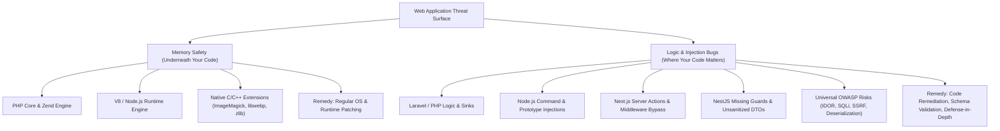

# Web Application Security Audit Protocol

An advanced engineering standard for identifying, assessing, and remediating realistic remote code execution (RCE), data breach, and privilege escalation vulnerabilities across Python (Django, FastAPI, Flask), PHP (Laravel, CodeIgniter), and Node.js (Next.js, NestJS, Express.js) web applications.

---

## 1. The Core Threat Boundary: Memory vs Logic & Injection



### Memory Bugs (Heap Overflow, Use-After-Free)
PHP, Node.js, and TypeScript are **memory-safe languages**. You cannot directly write a heap overflow or use-after-free bug in standard application code.
- **Where they live:** Inside the PHP Zend engine, the V8 JavaScript engine, native C extensions (`pecl`, `npm` native addons), and system libraries invoked by your app (`ImageMagick`, `libwebp`, `zlib`, `libxml2`).
- **Remediation:** Keep the underlying language runtime, container base images, and system packages updated.

### Logic and Injection Bugs
These represent the true attack paths for RCE, data theft, authentication bypass, and account takeover in application code.

---

## 2. Framework Threat Matrices & Dangerous Sinks

### 2.1 PHP & Laravel Attack Surface
- [ ] **Debug Mode Enabled in Production:** `APP_DEBUG=true` in `.env` leaks full environment variables, database credentials, and session keys upon any unhandled exception. In older Ignition versions, it allows unauthenticated RCE via CVE-2021-3129.
  - *Fix:* Ensure `APP_DEBUG=false` in production.
- [ ] **Leaked `APP_KEY`:** If `APP_KEY` is committed or leaked, attackers can forge signed cookies or encrypt malicious serialized payloads that Laravel decrypts and unserializes, leading to remote code execution.
  - *Fix:* Rotate `APP_KEY` immediately if exposed; never commit `.env`.
- [ ] **Mass Assignment:** Incomplete `$fillable` or loose `$guarded = []` on Eloquent models allows attackers to pass parameters like `is_admin=1`, `role=superadmin`, or `tenant_id`.
  - *Fix:* Always use explicit `$fillable` lists or dedicated FormRequest validation objects with `$request->validated()`.
- [ ] **Raw SQL Injections:** Concatenating user variables inside `DB::raw()`, `whereRaw()`, `selectRaw()`, `havingRaw()`, or `orderByRaw()`.
  - *Fix:* Use parameterized bindings: `whereRaw('status = ?', [$request->status])`.
- [ ] **Insecure Deserialization:** Direct invocation of native `unserialize()` on user input.
  - *Fix:* Use `json_decode()` exclusively.
- [ ] **Unescaped Blade Directives (XSS):** Rendering raw unescaped HTML using `{!! $variable !!}` instead of auto-escaped `{{ $variable }}`.
  - *Fix:* Use `{!! !!}` only for pre-sanitized HTML run through HTMLPurifier.
- [ ] **Exposed `.env` File:** Web server root incorrectly pointing to project root instead of `/public`.
  - *Fix:* Set Nginx/Apache document root strictly to `/path/to/laravel/public`.

> **Deep Dive:** Consult [`references/laravel-security-guide.md`](references/laravel-security-guide.md).

---

### 2.2 Node.js Attack Surface
- [ ] **OS Command Injection:** Invoking `child_process.exec()`, `execSync()`, or `spawn({ shell: true })` with user-supplied arguments.
  - *Fix:* Use `child_process.execFile()` or `spawn()` with arguments passed as an array without shell execution.
- [ ] **Dynamic Code Execution:** Use of `eval()`, `new Function()`, or Node's `vm` module with user input.
  - *Fix:* Eliminate dynamic evaluation; use deterministic parsing or safe expression engines.
- [ ] **Prototype Pollution:** Unsanitized recursive object merging or path assignment (`obj[key] = value`) allowing attackers to mutate `Object.prototype`, causing authentication bypasses or RCE gadgets.
  - *Fix:* Validate keys against `__proto__`, `constructor`, and `prototype`, or use `Object.create(null)` / `Map`.
- [ ] **NoSQL Injection:** Passing unvalidated JSON request bodies directly to MongoDB/Mongoose queries, enabling operator injection (`{"$gt": ""}`).
  - *Fix:* Validate payloads with Zod schemas or cast explicitly to string (`String(req.body.username)`).
- [ ] **Path Traversal:** Serving files using `path.join(__dirname, userInput)` without verifying that the resolved path remains inside the intended directory.
  - *Fix:* Verify containment: `resolvedPath.startsWith(allowedDir)`.
- [ ] **ReDoS (Regular Expression DoS):** Catastrophic backtracking in nested quantifiers (e.g. `(a+)+$`) freezing Node's single-threaded event loop.
  - *Fix:* Audit regexes with `safe-regex` or use RE2 linear-time regex engine.
- [ ] **Supply Chain Risks:** Malicious dependencies or postinstall scripts.
  - *Fix:* Run `npm audit`, use `package-lock.json` with hash pinning, and disable arbitrary lifecycle scripts where possible.

> **Deep Dive:** Consult [`references/nodejs-security-guide.md`](references/nodejs-security-guide.md).

---

### 2.3 Next.js (App Router & Pages) Attack Surface
- [ ] **Authorization Only in Middleware (CVE-2025-29927 Bypass):** Relying solely on `middleware.ts` for route protection without verifying authentication and permissions in the actual Server Component, Route Handler, or Server Action.
  - *Fix:* Defense-in-depth: Re-verify session and user capabilities inside every Server Action and Route Handler.
- [ ] **Client Secret Leaks via `NEXT_PUBLIC_`:** Exposing private database passwords, webhook signing secrets, or master API tokens by prefixing them with `NEXT_PUBLIC_`.
  - *Fix:* Reserve `NEXT_PUBLIC_` strictly for client-safe tokens (e.g. Google Maps key, Supabase anon key).
- [ ] **Cross-Site Scripting (XSS):** Injecting unsanitized markdown or user content into `dangerouslySetInnerHTML={{ __html: userContent }}`.
  - *Fix:* Sanitize with DOMPurify / sanitize-html before rendering.
- [ ] **Server-Side Request Forgery (SSRF):** Allowing arbitrary external domain queries in `<Image />` component optimization or server-side `fetch(userSuppliedUrl)`.
  - *Fix:* Restrict `images.remotePatterns` in `next.config.js` to trusted CDNs; validate internal IP ranges (e.g. `169.254.169.254`, `127.0.0.1`, RFC 1918) before fetching.
- [ ] **React Server Components (RSC) Deserialization:** Framework-level deserialization of server actions and flight payloads.
  - *Fix:* Keep Next.js and React versions pinned to recent, patched releases.

> **Deep Dive:** Consult [`references/nextjs-security-guide.md`](references/nextjs-security-guide.md).

---

### 2.4 NestJS Attack Surface
- [ ] **Missing Route Guards:** Controllers or route handlers lacking `@UseGuards(AuthGuard, RolesGuard)`, inadvertently exposing administrative endpoints.
  - *Fix:* Apply guards globally (`APP_GUARD`) or at the controller level; explicitly mark public routes with custom `@Public()` decorators.
- [ ] **DTO Over-Posting (Mass Assignment):** Global `ValidationPipe` instantiated without `whitelist: true` or `forbidNonWhitelisted: true`, allowing unexpected attributes to bypass validation.
  - *Fix:* Configure global pipe: `app.useGlobalPipes(new ValidationPipe({ whitelist: true, forbidNonWhitelisted: true, transform: true }));`
- [ ] **Raw ORM SQL Queries:** Using `repository.query("SELECT * FROM users WHERE email = '" + email + "'")` instead of parameterized TypeORM/Prisma bindings.
  - *Fix:* Always pass parameters in the binding array: `repository.query('SELECT * FROM users WHERE email = $1', [email])`.
- [ ] **Unthrottled Endpoints (DoS / Brute Force):** Missing rate limiting on authentication routes (`/auth/login`, `/auth/reset-password`).
  - *Fix:* Register `ThrottlerModule` and apply `@Throttle()` to sensitive routes.

> **Deep Dive:** Consult [`references/nestjs-security-guide.md`](references/nestjs-security-guide.md).

---

### 2.5 Python: Django, FastAPI & Flask Attack Surface
- [ ] **Django `DEBUG = True` & Wildcard `ALLOWED_HOSTS`:** `DEBUG = True` exposes interactive tracebacks and environment secrets; `ALLOWED_HOSTS = ['*']` enables host header poisoning for password reset spoofing and cache poisoning.
  - *Fix:* Ensure `DEBUG = False` and explicitly enumerate allowed host domains in production.
- [ ] **Raw SQL in Django ORM / SQLAlchemy:** Using `Model.objects.raw(f"SELECT ... {input}")`, `extra()`, or `db.execute(text(f"SELECT ... {input}"))`.
  - *Fix:* Pass query arguments in the parameters list: `objects.raw("SELECT ... %s", [input])` or `text("SELECT ... :param")`.
- [ ] **Template XSS (`mark_safe` / `|safe`):** Bypassing auto-escaping with `mark_safe(user_input)` in Django templates or views.
  - *Fix:* Sanitize HTML with `bleach` before `mark_safe`, or rely on native auto-escaping.
- [ ] **Insecure Deserialization (`pickle`):** Unpickling cookies, cache keys, or user sessions via `pickle.loads()`.
  - *Fix:* Use JSON or `django.core.signing` with cryptographic signatures.
- [ ] **Jinja2 SSTI in Flask:** Dynamic template rendering via `render_template_string(f"... {user_input}")`.
  - *Fix:* Pass parameters into the template context: `render_template_string("... {{ val }}", val=user_input)`.
- [ ] **SSRF in FastAPI/Flask HTTP Clients:** Unvalidated outbound requests via `httpx` or `requests.get(user_url)`.
  - *Fix:* Verify target IP is not private (RFC 1918), loopback, or cloud metadata (`169.254.169.254`).

> **Deep Dive:** Consult [`references/django-fastapi-security-guide.md`](references/django-fastapi-security-guide.md).

---

### 2.6 CodeIgniter & Standalone PHP Attack Surface
- [ ] **Raw Database Queries:** Using `$this->db->query("SELECT ... " . $input)` without query bindings.
  - *Fix:* Pass positional query bindings: `$this->db->query("SELECT ... ?", [$input])`.
- [ ] **Disabled CSRF Protection:** Setting `$config['csrf_protection'] = FALSE;` in `config/config.php`.
  - *Fix:* Enable CSRF protection globally with cookie token regeneration.
- [ ] **Disabled Input Filtering / Direct Output:** Accessing `$this->input->post('name', FALSE)` or directly echoing `$_POST` without escaping.
  - *Fix:* Use CodeIgniter 4's `esc($val, 'html')` or `htmlspecialchars()`.
- [ ] **Unrestricted Auto-Routing:** Public helper methods exposed via URL auto-routing in CI3/CI4 (`$routes->setAutoRoute(true)`).
  - *Fix:* Disable auto-routing and explicitly declare route contracts.

> **Deep Dive:** Consult [`references/codeigniter-php-security-guide.md`](references/codeigniter-php-security-guide.md).

---

### 2.7 Express.js & Fastify Attack Surface
- [ ] **Open Redirect:** Passing unvalidated user input directly to `res.redirect(req.query.url)`.
  - *Fix:* Validate that destination URLs are relative (`startsWith('/') && !startsWith('//')`).
- [ ] **Path Traversal via `res.sendFile()`:** Concatenating user filename input without specifying a restricted `root` directory.
  - *Fix:* Pass `path.basename(filename)` with an explicit `{ root: safeDir, dotfiles: 'deny' }` option.
- [ ] **Missing Security Headers:** Omitting `helmet()` middleware, leaving `X-Powered-By` exposed and lacking HSTS/CSP.
  - *Fix:* Mount `app.use(helmet())` at the top of the middleware stack.
- [ ] **Insecure CORS with Reflected Origin:** Using `cors({ origin: true, credentials: true })`.
  - *Fix:* Validate request origins against an explicit domain allowlist.

> **Deep Dive:** Consult [`references/expressjs-security-guide.md`](references/expressjs-security-guide.md).

---

## 3. Universal OWASP Vulnerabilities

| Vulnerability | Attack Mechanics | Production Defense |
|---|---|---|
| **IDOR / BOLA** | Modifying IDs in URLs/payloads (`/api/invoices/1042`) without checking whether the authenticated user owns the resource. | Query resources scoping to tenant/owner: `findFirst({ where: { id, userId: currentUser.id } })`. |
| **SQL Injection** | Attacker injects SQL commands via string concatenation. | Use ORM methods with parameterized bindings. Never concatenate strings into SQL queries. |
| **Command Injection** | Shell metacharacters (`|`, `;`, `&`, `$(...)`) passed to system shell. | Avoid shell calls; pass explicit argument arrays to `execFile` without shell execution. |
| **Cross-Site Scripting (XSS)** | Injecting `<script>` or event handlers into rendered HTML. | Context-aware HTML escaping; use Content Security Policy (`CSP`) headers. |
| **SSRF** | Server fetches user-controlled URL, accessing internal metadata services (`169.254.169.254`). | Block private IP spaces (RFC 1918, link-local, loopback) and DNS rebinding; use an explicit URL allowlist. |
| **Insecure Deserialization** | Unpacking untrusted serialized objects (PHP `unserialize()`, Node `serialize-javascript`). | Never deserialize untrusted binary/serialized objects; use JSON schemas. |

> **Deep Dive:** Consult [`references/universal-vulnerabilities.md`](references/universal-vulnerabilities.md).

---

## 4. Automated Vulnerability Scanning

Use the bundled static analysis scanner to check codebases for dangerous sinks across PHP, JavaScript, and TypeScript files:

```bash
# Scan a specific file or full repository
python3 web-app-security-audit/scripts/scan_vulnerabilities.py ./src

# Output machine-readable JSON for CI/CD gates
python3 web-app-security-audit/scripts/scan_vulnerabilities.py ./src --json
```

---

## 5. Security Audit Checklist

Run through this checklist for every web application pull request or audit:
- [ ] **No Raw String SQL Concatenation:** All queries use parameterized bindings or ORM builder syntax.
- [ ] **No Shell Invocations with Input:** `child_process.exec()` / `system()` is absent or sanitized with fixed argument arrays.
- [ ] **Input Validation Enforced:** Every endpoint validates input through a schema (Laravel `FormRequest`, Zod, Joi, `ValidationPipe`).
- [ ] **Endpoint-Level Authorization:** Object-level authorization (IDOR check) is enforced on every controller/handler, not assumed from middleware.
- [ ] **Safe HTML Rendering:** No `{!! !!}` in Blade, no `dangerouslySetInnerHTML` in React without HTMLPurifier/DOMPurify sanitization.
- [ ] **Secret Hygiene:** Zero secrets in client bundles (`NEXT_PUBLIC_`), zero committed `.env` files, production debug mode turned off (`APP_DEBUG=false`).
- [ ] **Outdated Dependencies Vetted:** `composer audit` and `npm audit` return zero critical/high vulnerabilities.
- [ ] **SSRF Protections Active:** Outbound fetches validate destination protocols and block local/metadata IP ranges.
- [ ] **Mass Assignment Blocked:** Models define explicit `$fillable` arrays or DTOs enforce `whitelist: true`.
